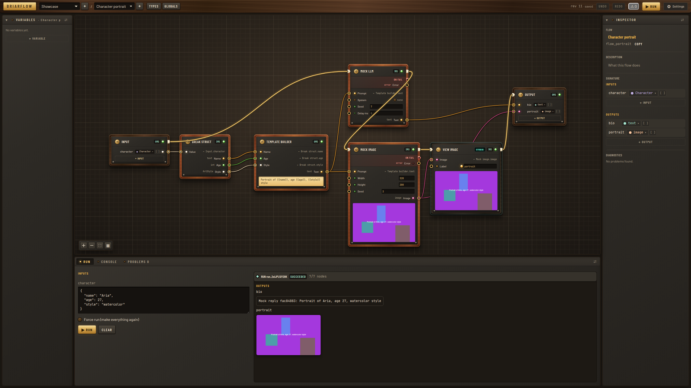

# Briarflow

**A strongly typed, graph-based framework for building AI pipelines — prompt construction, LLM calls, structured outputs, image processing, and custom logic, composed as flows of typed nodes connected by type-checked wires.**



Briarflow is **library first**. You compose **flows** from typed **nodes** — text templates, struct constructors, LLM and image-generation calls, image processors, and your own TypeScript or Python functions — connected by wires that the type checker validates before a run starts.

Because flows are plain JSON documents, the exact same flow runs:
- **In-process as a TypeScript library** via `createBriar()` from `briarflow`
- **Behind a REST + Server-Sent Events API** via `@briarflow/server` and `@briarflow/client`
- **Interactively in the studio**, the React visual editor that ships with the server

---

## Why Briarflow

| | |
|---|---|
| **Library, service, or studio** | Author and run flows in-process from TypeScript, serve them over HTTP + SSE, or draw and debug them visually in the studio. |
| **Typed end to end** | Primitives, structs, enums, lists, optionals, generics, and first-class media types (`image`, `video`, `audio`, `model3d`, `file`). Invalid wires, configs, and inputs are rejected with clear diagnostics explaining what is wrong, where, and how to fix it. |
| **Built for AI pipelines** | Explicit execution order lines with failure branches, on-demand pure nodes, retries with exponential backoff, timeouts, `AbortSignal` cancellation, result caching, concurrency limits, and streamed progress events. |
| **Extensible in TS & Python** | Build node packs in TypeScript (`defineNode`, `definePack`), expose Python functions as nodes through a zero-dependency worker (`@node`, `serve`), and plug in storage backends (SQLite, filesystem, memory) and encrypted secret vaults. |
| **Connects to everything** | Every flow is a typed HTTP endpoint that publishes a JSON Schema signature. Trigger runs from webhooks, cron, CI, or workflow tools (n8n, Zapier); offer flows as tools to LLM agents; or embed the API and React editor in your own product. |

---

## Quick start

### 1. Run the server and studio with Docker

```bash
docker build -t briarflow .
docker run -p 3000:3000 -v briarflow-data:/data briarflow
```

Open <http://localhost:3000> for the studio; the REST API is served at `http://localhost:3000/api/v1`. Or run with Docker Compose:

```bash
docker compose up --build
```

Contexts, the media registry, last runs, the encrypted vault, and settings are stored in SQLite under `/data`, alongside uploaded media files. Pass `-e ANTHROPIC_API_KEY=…` to enable Claude nodes; OpenAI keys are configured in the studio (**Settings → OpenAI**) and stored encrypted in the vault.

### 2. Use it as a TypeScript library

> Packages in this repository are currently versioned `0.0.0` and **not published to npm yet** — run and import them from a checkout of this monorepo.

```ts
import { createBriar } from "briarflow";
import { mockPack } from "@briarflow/nodes-mock";

const briar = createBriar({ packs: [mockPack] });

const ctx = await briar.contexts.create({ name: "Demo" });
const flow = ctx.flows.create("Poster");
flow.inputs.add("topic", "text");
flow.outputs.add("caption", "text");
flow.outputs.add("poster", "image");

const llm = flow.nodes.add("mock.llm");
const image = flow.nodes.add("mock.image");
flow.connect(flow.input.port("topic"), llm.port("prompt"));
flow.connect(llm.port("text"), image.port("prompt"));
flow.connect(llm.port("text"), flow.output.port("caption"));
flow.connect(image.port("image"), flow.output.port("poster"));
flow.line(flow.input, llm, image, flow.output);   // execution order
await ctx.save();

const run = await briar.run(flow.id, { topic: "a lighthouse at dusk" });
for await (const event of run.events()) console.log(event.type);  // run.started, node.started, node.progress, …
const result = await run.result;
console.log(result.status, result.outputs);  // "succeeded", { caption: "…", poster: { mediaId: "med_…" } }

const bytes = await briar.media.read(result.outputs.poster);       // Uint8Array of the generated image
await briar.close();
```

To call real providers, swap `mockPack` for:
- `anthropicPack()` from `@briarflow/nodes-anthropic` (with `secrets: envSecrets()`)
- `openaiPack()` from `@briarflow/nodes-openai` (configured with a secret vault)

For persistent storage on disk, configure SQLite and filesystem stores:

```ts
import { FsMediaStore } from "@briarflow/storage-fs";
import { SqliteContextStore, SqliteLastRunStore, SqliteMediaRegistry } from "@briarflow/storage-sqlite";

const file = "./data/briarflow.db";
const briar = createBriar({
  store: new SqliteContextStore({ file }),
  media: new SqliteMediaRegistry({ file }),
  lastRuns: new SqliteLastRunStore({ file }),
  blobs: new FsMediaStore({ dir: "./data/media" }),
  packs: [mockPack],
});
```

### 3. Local development

Requires **Node >= 20.19** (and **Python >= 3.10** if working with Python nodes).

```bash
npm install
npm run dev:server        # API on http://localhost:3000
npm run dev:studio        # Studio on http://localhost:5173 (proxies /api to :3000)
npm run smoke             # End-to-end smoke check against the running server
npm test                  # All Vitest suites
npm run typecheck         # TypeScript check across workspaces
cd python && python -m pytest
```

---

## How it works

### Core concepts

| Concept | Role |
|---|---|
| **Context** | An immutable, revision-numbered JSON document holding flows, shared struct/enum types, and global variables. Edited atomically through a JSON command set with undo/redo. |
| **Flow** | A graph with a typed input and output signature. Exposes its signature as JSON Schema so external services and LLM agents can validate inputs and inspect outputs. |
| **Node** | A typed operation from a **pack** (`openai.image`, `anthropic.structured`, `text.template`, `image.resize`). Supports typed ports, config, model variants, retries, timeouts, and caching. |
| **Wires** | Data edges between ports. Generic type variables (`$T`) unify across connected wires, and incompatible connections are rejected immediately. |
| **Execution line** | Defines the sequence of side-effecting nodes and optional `failed` branches. **Pure** nodes (templates, member access, image transforms) have no execution line and evaluate on demand when read. |
| **Variables** | Flow-local variables and context-wide globals (`readonly` or `readwrite`) with validated read/write ordering. |
| **Media** | Media values travel through flows as `{ mediaId }` references into a **media registry** that tracks metadata (MIME type, dimensions, size) and resolves bytes from SQLite, disk blobs, or URLs. |

### Node packs

| Pack | Included nodes |
|---|---|
| `briar` (`@briarflow/nodes-std`, built in) | Flow input/output, constants, struct make/break, member get/set (`.field`, `.width`, `.mime`), text template and join, list ops, JSON get/parse/stringify, type conversions, flow/global variables, studio `Print` and `View image` nodes |
| `image` (`@briarflow/nodes-image`) | Make image (from RGBA/RGB channels or solid color), Split channels, Resize (contain/cover/stretch), Crop, Rotate/flip, Grayscale, Invert, Convert (PNG/JPEG in pure JS, no native dependencies) |
| `openai` (`@briarflow/nodes-openai`) | Text and structured outputs (Responses API) and image generation (Images API, with model variants, custom sizes, quality, format, and background controls) |
| `anthropic` (`@briarflow/nodes-anthropic`) | Claude messages (`anthropic.message`) and structured outputs (`anthropic.structured`) |
| `mock` (`@briarflow/nodes-mock`) | Deterministic fake LLM, structured output, image, and 3D nodes, plus delay, flaky, and fail nodes for tests and offline demos |
| Python packs (`@briarflow/python` + `python/`) | Any pack served by a Python worker process (`@node` functions), loaded dynamically at runtime |

### The visual studio

The server ships with **the studio**, a browser editor built on `@briarflow/editor` and `@briarflow/editor-react`. It lets you edit flow signatures inline on the canvas, wire data and execution lines, inspect live node progress and inline media previews, access nested struct fields or media metadata by dropping a wire on empty canvas, manage struct/enum types and encrypted vault secrets, and inspect run outputs and errors in the console.

---

## Use it from anywhere

### Trigger flows over HTTP (webhooks, cron, CI, n8n, Zapier, workers)

```bash
curl -X POST "http://localhost:3000/api/v1/flows/flow_portrait/runs?wait=true" \
  -H 'content-type: application/json' \
  -d '{ "inputs": { "character": { "name": "Aria", "age": 27, "style": "watercolor" } } }'
# → { "status": "succeeded", "outputs": { "bio": "…", "portrait": { "mediaId": "med_…" } } }

curl -o portrait.png http://localhost:3000/api/v1/media/med_…
```

Runs started without `?wait=true` (or runs that exceed `waitMs`) return `202 Accepted` and stream live progress over Server-Sent Events at `GET /api/v1/runs/:runId/events` (resumable via `Last-Event-ID` or `?after=<seq>`).

### Call from TypeScript with the typed client

```ts
import { createBriarClient } from "@briarflow/client";

const client = createBriarClient({ baseUrl: "https://briar.internal/api/v1" });
const run = await client.flows.run("flow_portrait", { character: { name: "Aria", age: 27, style: "anime" } });
for await (const e of run.events()) if (e.type === "node.progress") console.log(e.fraction);
const { outputs } = await run.result;
const image = await client.media.download(outputs.portrait.mediaId);
```

### Embed the API in your own backend

`@briarflow/server` builds a standard [Hono](https://hono.dev) app with a per-action `authorize` hook. Mount custom routes alongside it or run `api.fetch` on Node, Bun, Deno, or Cloudflare Workers:

```ts
import { createBriarApp, serve } from "@briarflow/server";

const api = createBriarApp(briar, {
  authorize: ({ action, c }) => c.get("user")?.can(action) ?? false,  // flows.run, contexts.edit, …
});
api.post("/api/v1/portraits", async (c) => {
  const run = await briar.run("flow_portrait", await c.req.json());
  return c.json((await run.result).outputs);
});
await serve(api, { port: 8080 });
```

### Offer flows as tools to LLM agents

`GET /api/v1/flows/:flowId` returns the flow along with its input and output JSON Schema (`signature.inputs` and `signature.outputs`). Pass `signature.inputs` as a tool definition to an LLM agent, and invoke `POST /api/v1/flows/:flowId/runs?wait=true` with the model's arguments when the tool is called.

### Embed the visual editor in a React app

```tsx
const store = createEditorStore({ backend: clientBackend(client), contextId: "ctx_marketing" });

<EditorProvider store={store} mediaUrl={(id) => client.media.url(id)} mediaEntry={(id) => client.media.entry(id)}>
  <FlowCanvas />
  <RunPanel />
</EditorProvider>
```

---

## Extend with custom nodes

### TypeScript nodes

```ts
import { defineNode, definePack, t } from "@briarflow/core";

export const shout = defineNode({
  type: "words.shout",
  title: "Shout",
  category: "Text",
  inputs: { text: t.text(), times: { type: t.int({ min: 1, max: 5 }), default: 1 } },
  outputs: { text: t.text() },
  run: ({ inputs }) => ({ text: (inputs.text.toUpperCase() + "!").repeat(inputs.times) }),
});

export const thumbnail = defineNode({
  type: "words.thumbnail",
  inputs: { image: t.image({ formats: ["png", "jpeg"] }) },
  outputs: { image: t.image() },
  async run({ inputs, ctx }) {
    const bytes = await ctx.media.read(inputs.image);
    const small = await makeThumbnail(bytes);
    return { image: await ctx.media.put(small, { mime: "image/png", filename: "thumb.png" }) };
  },
});

export const wordsPack = definePack({ name: "words", version: "1.0.0", title: "Words", nodes: [shout, thumbnail] });
```

Port types infer static TypeScript types inside `run`, render appropriate input widgets in the studio, and can be unit-tested with `runNode()` and `describeNodePack()` from `@briarflow/testing`. See the [Writing nodes guide](docs/guides/writing-nodes.md).

### Python nodes

For workloads using PyTorch, diffusers, OpenCV, or other Python libraries, write functions with the zero-dependency Python SDK and run them as a worker process:

```python
from briarflow import ExecContext, Image, node, pack, serve

@node(title="Solid color image", category="Image")
def solid_image(color: str, width: int = 64, height: int = 64, *, ctx: ExecContext) -> Image:
    """Creates a PNG filled with one color."""
    ctx.progress(0.5, "encoding")
    return ctx.media.create(make_png(width, height, color), mime="image/png", width=width, height=height)

serve(pack("imaging", "0.1.0", nodes=[solid_image]))
```

Load the worker in TypeScript via `spawnPythonWorker()` / `pythonPack({ url, token })` from `@briarflow/python`, or point the server at it with `BRIAR_PYTHON_WORKER_URL`. Python type hints (`str`, `int`, `Image`, `@struct` dataclasses, `Enum`, `Annotated` constraints) map directly to Briarflow types. See the [Python nodes guide](docs/guides/python-nodes.md).

---

## Deployment options

| Mode | When to use | How to run |
|---|---|---|
| **Single container** (server + studio) | Internal team tool, self-hosted service, or demo | `docker run -p 3000:3000 -v briarflow-data:/data briarflow` — everything persists on `/data`. |
| **Docker Compose** | Running alongside a Python worker or reverse proxy | `docker compose up --build` (uncomment `BRIAR_PYTHON_WORKER_URL` to attach a Python worker). |
| **Plain Node** | VMs, bare metal, or PaaS (Fly.io, Render, Railway) | `npm ci && npm run build -w @briarflow/studio && npm start` with `HOST=0.0.0.0`, `PORT`, and `BRIAR_DATA_DIR` on a persistent disk. |
| **Embedded API** | Inside an existing backend with custom auth | `createBriarApp(briar, { authorize })` mounted in Hono, Node, Bun, Deno, or any Fetch runtime. |
| **Library only** | CLI tools, background workers, batch jobs, tests | `createBriar()` in-process with memory or SQLite stores; no HTTP server needed. |
| **Headless API + custom UI** | Products embedding their own workflow UI | Run with `BRIAR_STUDIO_DIR=off` and connect via `@briarflow/client` and `@briarflow/editor-react`. |

### Production notes

- **Authentication:** The bundled server (`apps/server`) has no built-in login. Keep it on `localhost` or a private network, place an authenticating reverse proxy in front of it, or embed `@briarflow/server` with an `authorize` hook.
- **One process per SQLite file:** Each server cleans up temporary run media on startup and after runs complete. Do not point multiple processes at the same `briarflow.db`.
- **Vault encryption key:** Secrets in the vault are encrypted with AES-256-GCM using `BRIAR_VAULT_KEY` (or `<BRIAR_DATA_DIR>/vault.key`, generated automatically on first start). Back up the key alongside your database.
- **Health checks:** `GET /health` returns `200 ok` and is wired into the container `HEALTHCHECK`.

---

## Configuration

| Environment variable | Default | Description |
|---|---|---|
| `PORT` | `3000` | HTTP listen port |
| `HOST` | `127.0.0.1` (`0.0.0.0` in Docker) | Bind address |
| `BRIAR_DATA_DIR` | `./data` (`/data` in Docker) | Directory holding `briarflow.db`, `vault.key`, and `media/` |
| `BRIAR_VAULT_KEY` | `<BRIAR_DATA_DIR>/vault.key` | 64-character hex key for AES-256-GCM vault encryption |
| `BRIAR_CORS_ORIGIN` | `http://localhost:5173,http://127.0.0.1:5173` | Comma-separated allowed origins, or `off` |
| `BRIAR_STUDIO_DIR` | `apps/studio/dist` | Path to the built studio served at `/` (`off` to disable) |
| `BRIAR_STUDIO_CONTEXT`, `BRIAR_STUDIO_FLOW` | — | Initial context and flow opened in the studio (created on startup if missing) |
| `BRIAR_MOCK_NODES` | `true` | Load the deterministic `mock` node pack |
| `BRIAR_PYTHON_WORKER_URL`, `BRIAR_PYTHON_WORKER_TOKEN` | — | Load a remote Python worker pack at startup |
| `ANTHROPIC_API_KEY` | — | API key that enables the `@briarflow/nodes-anthropic` pack |
| `BRIAR_LOG_LEVEL` | `info` | Log verbosity (`debug` enables request-level logs) |

### REST API at a glance

| Area | Endpoints | Purpose |
|---|---|---|
| **Contexts** | `GET/POST /contexts`, `GET/DELETE /contexts/:id` | List, create, load, and delete context documents |
| **Authoring** | `POST /contexts/:id/commands`, `GET /contexts/:id/diagnostics` | Apply atomic command batches with optimistic revision checks |
| **Flows** | `GET /flows/:id`, `GET /flows/:id/last-run` | Fetch flow definition, JSON Schema signature, and last run state |
| **Runs** | `POST /flows/:id/runs` (`?wait`, `force`), `GET /runs/:id`, `GET /runs/:id/events` (SSE), `POST /runs/:id/cancel` | Start runs, await results, stream SSE progress, or cancel |
| **Media** | `POST /media`, `POST /media/links`, `GET /media/:id`, `GET /media/:id/entry` | Upload bytes, register URLs, download media, and inspect metadata |
| **Catalog** | `GET /node-types` | List loaded packs, node descriptors, and pack types (with ETag caching) |
| **Vault & settings** | `GET/POST /secrets`, `POST/DELETE /secrets/:name`, `GET/POST /settings` | Write-only secret storage and per-pack settings |

Full specification: [docs/specs/rest-api.md](docs/specs/rest-api.md).

---

## Packages

| Package | Description |
|---|---|
| [`briarflow`](packages/briarflow) | High-level facade: `createBriar()`, fluent authoring handles, run registry, in-memory stores, `envSecrets()` |
| [`@briarflow/core`](packages/core) | Type system, document model, `defineNode` / `definePack`, validation, JSON Schema compiler, media registry and loader |
| [`@briarflow/authoring`](packages/authoring) | JSON command set and `ContextEditor` with undo/redo |
| [`@briarflow/runtime`](packages/runtime) | Execution engine: scheduling, execution lines, retries, timeouts, caching, carry-over, and cancellation |
| [`@briarflow/nodes-std`](packages/nodes-std) | Standard built-in nodes (`briar`, `text`, `list`, `json`, `convert`, `debug`) |
| [`@briarflow/nodes-image`](packages/nodes-image) | Pure-JS image creation and processing nodes |
| [`@briarflow/nodes-openai`](packages/nodes-openai), [`@briarflow/nodes-anthropic`](packages/nodes-anthropic) | OpenAI and Anthropic provider node packs |
| [`@briarflow/nodes-mock`](packages/nodes-mock) | Deterministic fake AI nodes for testing and demos |
| [`@briarflow/storage-sqlite`](packages/storage-sqlite), [`@briarflow/storage-fs`](packages/storage-fs) | SQLite stores (contexts, media registry, last runs, vault, settings) and filesystem stores |
| [`@briarflow/python`](packages/python) + [`python/`](python) | Zero-dependency Python node SDK (`briarflow`) and TypeScript worker bridge |
| [`@briarflow/server`](packages/server) | Portable Hono REST + SSE API server |
| [`@briarflow/client`](packages/client) | Typed HTTP + SSE client SDK |
| [`@briarflow/editor`](packages/editor), [`@briarflow/editor-react`](packages/editor-react) | Framework-agnostic editor store and React Flow visual canvas |
| [`@briarflow/testing`](packages/testing) | `runNode` helper, store and pack conformance suites, and test fixtures |
| [`apps/server`](apps/server), [`apps/studio`](apps/studio) | Runnable Node server and React visual studio |

Shared packages (`core`, `authoring`, `runtime`, `nodes-std`, `nodes-mock`, `client`, `editor`) use web-standard APIs only (`Promise`, `AbortSignal`, `AsyncIterable`, `fetch`, `ReadableStream`, `Uint8Array`) with no Node-only or React dependencies.

---

## Documentation & status

- **Architecture & roadmap:** [Architecture](docs/ARCHITECTURE.md) · [Status](docs/STATUS.md) · [Phases](docs/PHASES.md) · [Decisions](docs/DECISIONS.md)
- **Guides:** [Writing nodes](docs/guides/writing-nodes.md) · [Python nodes](docs/guides/python-nodes.md) · [Writing a store](docs/guides/writing-a-store.md)
- **Specifications:** [Types](docs/specs/types.md) · [Node API](docs/specs/node-api.md) · [Media](docs/specs/media.md) · [Commands](docs/specs/commands.md) · [Runtime](docs/specs/runtime.md) · [REST API](docs/specs/rest-api.md) · [Storage](docs/specs/storage.md) · [Variables](docs/specs/variables.md) · [Design system](docs/specs/design-system.md)
- **Contributing:** [AGENTS.md](AGENTS.md)

### Status

The MVP is feature-complete and backed by 2,290+ automated tests across Vitest and pytest, covering the core type system, authoring commands, runtime engine, standard/image/OpenAI/Anthropic/mock packs, SQLite and filesystem stores, Python SDK and bridge, REST server and client, and visual studio.

Packages are currently versioned `0.0.0` and are **not published to npm yet**; use them directly from this monorepo (each package builds with `tsdown`). Remaining post-MVP items are tracked in [docs/STATUS.md](docs/STATUS.md#after-mvp-next).

### License

MIT, as declared in the package manifests.
