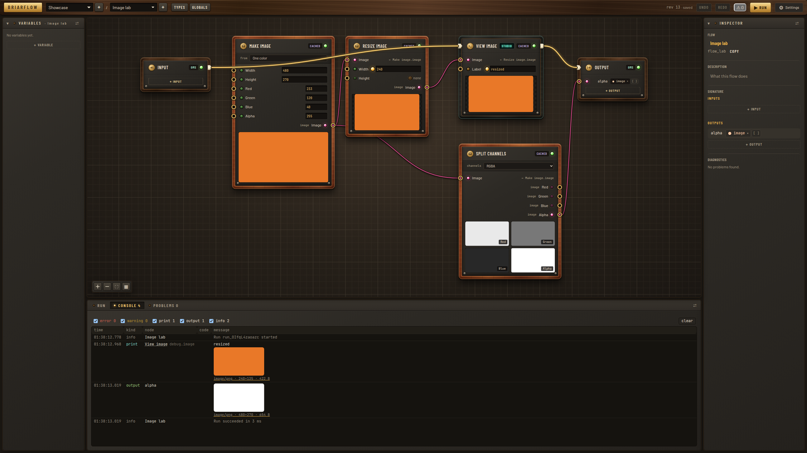
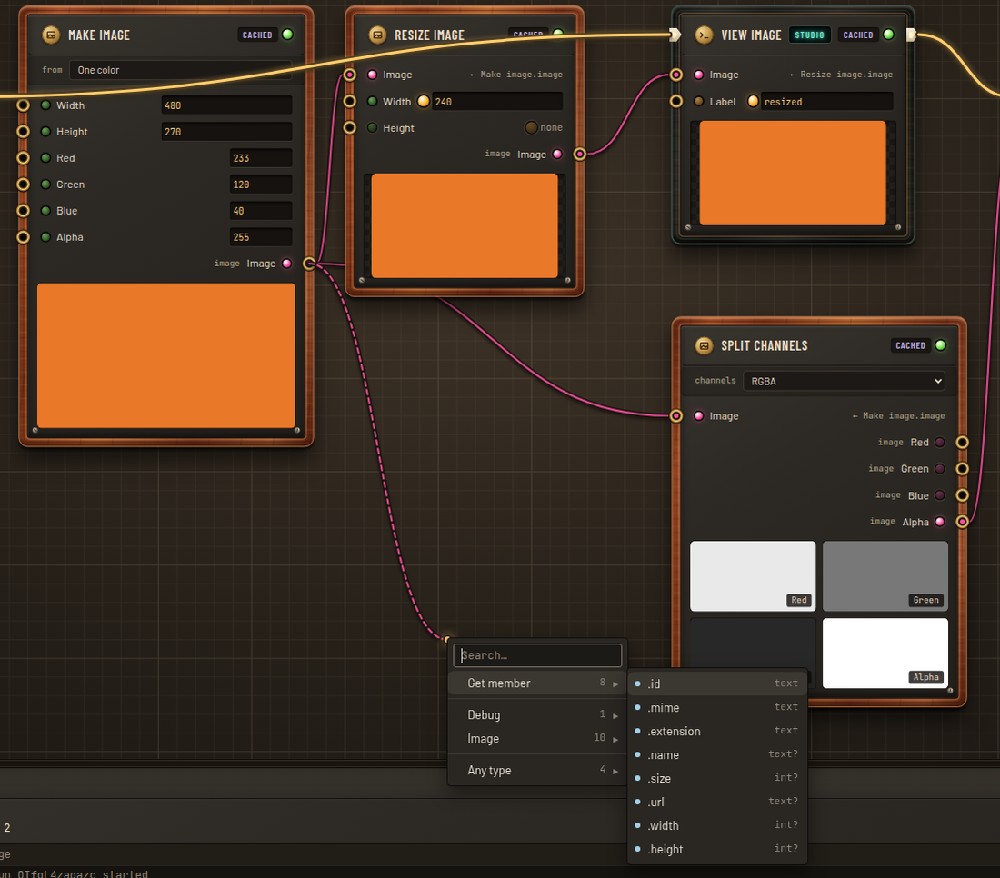
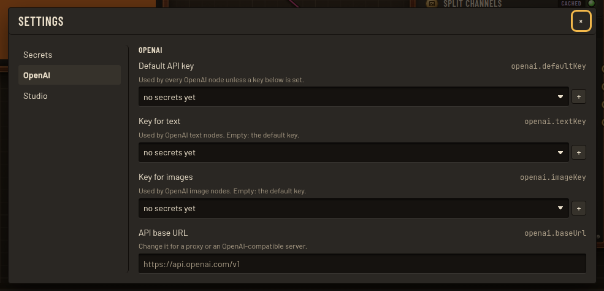

# Briarflow

**Typed, visual AI pipelines you can draw in a studio, run as a service, or embed as a library — prompts, LLM calls and media in one graph where every wire is type-checked.**


Briarflow is a strongly typed, graph-based framework for prompt construction and AI-result
pipelines. You build **flows** from typed **nodes**: text templates, struct make/break, LLM
calls, image generators and processors, your own TypeScript or Python nodes. You connect them
with wires the type checker validates, and run them with streamed progress events.

It is **library first**. The same flow runs in-process (`createBriar()`), over HTTP
(`@briarflow/server` + `@briarflow/client`), or from the visual **studio** that ships with the
server.

---

## Contents

- [Why Briarflow](#why-briarflow)
- [Tour of the studio](#tour-of-the-studio)
- [Quick start](#quick-start): Docker · library · development
- [Core ideas](#core-ideas)
- [Node packs](#node-packs)
- [Connect it to everything else](#connect-it-to-everything-else)
- [Write your own nodes](#write-your-own-nodes): TypeScript · Python
- [Deployment options](#deployment-options)
- [Configuration](#configuration)
- [REST API at a glance](#rest-api-at-a-glance)
- [Packages](#packages)
- [Docs](#docs)
- [Project status](#project-status)

---

## Why Briarflow

| | |
|---|---|
| **Typed end to end** | Structs, enums, lists, optionals, media types (`image`, `video`, `audio`, `model3d`, `file`) and generics. Every wire, constant and run input is checked. Errors say what is wrong, where, and how to fix it. |
| **One flow, three ways to run it** | In your process as a library, behind a REST + SSE API, or from the studio. The flow document is plain JSON, the same everywhere. |
| **Built for AI work** | Retries with backoff, timeouts, cancellation, rate-limit handling, a result cache, and streamed progress. Media is first class: a registry of images, video and files, with previews on the nodes. |
| **Never pays twice for the same artifact** | Each flow keeps its last run. Nodes that make media and get the same inputs reuse their previous result instead of calling the model again. **Force run** regenerates everything. |
| **Visual and code-friendly** | Draw flows in the studio, or build them with a fluent TypeScript API, a JSON command set with undo/redo, or REST. |
| **Pluggable** | Node packs (`definePack`), storage (`ContextStore`, media registry, blob store), secrets vault, settings, and Python nodes through a worker. |
| **Testable** | `runNode`, conformance suites for node packs and stores, deterministic mock AI nodes, and 2,290+ tests in the repo. |

## Tour of the studio

**Image pipelines with live previews.** Every node with an image or video output shows what the
last run produced. Double-click opens a large viewer. The **View image** debug node sits on the
execution line and also writes the image, its size and type to the console.



**The dot operator, visually.** Drag a wire from any output into empty space and the menu
offers matching nodes, plus every member of the value's type. For an image that means
`.mime`, `.width` and `.size`; for a struct, its fields, nested as `.portrait.image.width`.
Struct fields can be read and set; everything else is read-only.

<p align="center"></p>

**Secrets stay on the server.** API keys live in an encrypted vault and are picked by name in
Settings. Values never come back to the browser; nodes read them on the server at run time.

<p align="center"></p>

Also in the studio:
- execution lines, with a failure branch per node;
- flow and global variables;
- a struct and enum editor;
- node variants, such as one OpenAI image node with a model dropdown;
- a problems panel with clickable diagnostics;
- undo/redo, plus a console that collects prints, outputs, retries and errors.

## Quick start

### 1. Run the studio with Docker (one container)

```bash
docker build -t briarflow .
docker run -p 3000:3000 -v briarflow-data:/data briarflow
```

Open <http://localhost:3000>. The API lives at `http://localhost:3000/api/v1`. Or use Compose:

```bash
docker compose up --build
```

Contexts, the media registry, last runs, the vault and settings live in SQLite under `/data`;
uploaded files sit next to it. To enable the Claude nodes, pass `-e ANTHROPIC_API_KEY=…`.
OpenAI keys are added in the studio (**Settings → OpenAI**) and stored encrypted.

### 2. Use it as a library

```ts
import { createBriar } from "briarflow";
import { mockPack } from "@briarflow/nodes-mock";

const briar = createBriar({ packs: [mockPack] });

const ctx = await briar.contexts.create({ name: "Demo" });
const flow = ctx.flows.create("Poster");
flow.inputs.add("topic", "text");
flow.outputs.add("caption", "text");
flow.outputs.add("poster", "image");

const llm = flow.nodes.add("mock.llm");
const image = flow.nodes.add("mock.image");
flow.connect(flow.input.port("topic"), llm.port("prompt"));
flow.connect(llm.port("text"), image.port("prompt"));
flow.connect(llm.port("text"), flow.output.port("caption"));
flow.connect(image.port("image"), flow.output.port("poster"));
flow.line(flow.input, llm, image, flow.output);   // the execution line
await ctx.save();

const run = await briar.run(flow.id, { topic: "a lighthouse at dusk" });
for await (const event of run.events()) console.log(event.type);  // run.started, node.started, node.progress, …
const result = await run.result;
console.log(result.status, result.outputs);  // "succeeded", { caption: "…", poster: { mediaId: "med_…" } }

const bytes = await briar.media.read(result.outputs.poster);       // the image itself
await briar.close();
```

To use real models, swap `mockPack` for a provider:
- `anthropicPack()` from `@briarflow/nodes-anthropic`, with `secrets: envSecrets()`;
- `openaiPack()` from `@briarflow/nodes-openai`, with a vault.

For persistent storage, pass SQLite stores:

```ts
import { FsMediaStore } from "@briarflow/storage-fs";
import { SqliteContextStore, SqliteLastRunStore, SqliteMediaRegistry } from "@briarflow/storage-sqlite";

const file = "./data/briarflow.db";
const briar = createBriar({
  store: new SqliteContextStore({ file }),
  media: new SqliteMediaRegistry({ file }),        // media entries; run artifacts as raw bytes
  lastRuns: new SqliteLastRunStore({ file }),      // the last run of each flow
  blobs: new FsMediaStore({ dir: "./data/media" }), // uploaded files
  packs: [mockPack],
});
```

### 3. Develop on the repo

```bash
npm install
npm run dev:server        # API on http://localhost:3000 (data in apps/server/data)
npm run dev:studio        # studio on http://localhost:5173, proxies /api to :3000
npm run smoke             # end-to-end check against the running server
npm test                  # every Vitest suite
npm run typecheck
cd python && python -m pytest
```

Requires Node ≥ 20.19. Python nodes need Python ≥ 3.10.

## Core ideas

| Idea | In one line |
|---|---|
| **Context** | A document holding flows, struct/enum types and global variables. Immutable, versioned by `revision`, edited through commands. |
| **Flow** | A graph with typed **inputs** and **outputs**, like a function signature. It is exposed as JSON Schema, so other tools can call it. |
| **Node** | A typed function from a **pack** (`openai.image`, `text.template`, `image.resize`, …). Nodes can have config, variants, retries, timeouts and a cache. |
| **Wires** | Data edges. Generics bind across wires (`T` becomes `Character`). An incompatible wire is refused with a reason. |
| **Execution line** | The order side effects happen in. **Pure** nodes (templates, image math, member access) have no line: they run when something on the line reads them. |
| **Variables** | Flow variables and context-wide globals, read and written by nodes (globals can be read-only). |
| **Media** | A media value is `{ mediaId }`, a key into the **media registry**. The registry knows each item's mime type, size, dimensions and file name, and where the bytes are: in the database, in a file store, or at a URL. A loader with an in-memory cache reads any of them. |
| **Last run** | Each flow keeps its last run, so previews survive a reload. Run artifacts are temporary and are removed when a newer run replaces them. Unchanged media-making nodes are **carried over** instead of being called again. |
| **Frontend nodes** | Nodes whose effect happens in the studio: **Print** and **View image**. |

## Node packs

| Pack | Nodes |
|---|---|
| `briar` (std, always on) | inputs/outputs, constants, struct make/break, **Get/Set member**, text template and join, list tools, JSON get/parse/stringify, type conversions, flow and global variables, **Print**, **View image** |
| `image` | Make image (from RGBA/RGB channels or one color), Split channels, Resize (contain/cover/stretch), Crop, Rotate/flip, Grayscale, Invert, Convert (PNG/JPEG). Pure JavaScript codecs, no native modules. |
| `openai` | Text and structured output, and **image generation**: GPT Image 2.5 Flare/Sunburst, GPT Image 2, and older models marked deprecated. Covers custom sizes, quality, format, background and moderation. |
| `anthropic` | Claude messages and structured output (`anthropic.message`, `anthropic.structured`) |
| `mock` | Deterministic fake LLM, structured, image and 3D nodes, plus delay, flaky and fail nodes, for demos and tests |
| Python packs | Any pack served by a Python worker (`@node` functions), loaded at runtime |

## Connect it to everything else

Briarflow is meant to be called by other systems, so a flow is just a typed endpoint.

**Trigger a flow from anything that speaks HTTP.** That covers cron, CI, n8n, Zapier, Make,
GitHub Actions, webhooks and queue workers:

```bash
curl -X POST "http://localhost:3000/api/v1/flows/flow_portrait/runs?wait=true" \
  -H 'content-type: application/json' \
  -d '{ "inputs": { "character": { "name": "Aria", "age": 27, "style": "watercolor" } } }'
# → { "status": "succeeded", "outputs": { "bio": "…", "portrait": { "mediaId": "med_…" } } }

curl -o portrait.png http://localhost:3000/api/v1/media/med_…
```

Long runs return `202` and stream progress over Server-Sent Events
(`GET /runs/:id/events`), which can resume with `Last-Event-ID`.

**Call it from TypeScript with the typed client:**

```ts
import { createBriarClient } from "@briarflow/client";

const client = createBriarClient({ baseUrl: "https://briar.internal/api/v1" });
const run = await client.flows.run("flow_portrait", { character: { name: "Aria", age: 27, style: "anime" } });
for await (const e of run.events()) if (e.type === "node.progress") console.log(e.fraction);
const { outputs } = await run.result;
const image = await client.media.download(outputs.portrait.mediaId);
```

**Embed the API in your own server, with your own auth and routes:**

```ts
import { createBriarApp, serve } from "@briarflow/server";

const api = createBriarApp(briar, {
  authorize: ({ action, c }) => c.get("user")?.can(action) ?? false,   // per action: flows.run, contexts.edit, …
});
api.post("/api/v1/portraits", async (c) => {
  const run = await briar.run("flow_portrait", await c.req.json());
  return c.json((await run.result).outputs);
});
await serve(api, { port: 8080 });   // or mount `api.fetch` in Hono, Bun, Deno, Cloudflare or any Fetch runtime
```

**Use flows as tools for an agent.** Every flow publishes its signature as JSON Schema
(`GET /flows/:id`). Hand that schema to an LLM as a tool definition and call the run endpoint
when it picks the tool.

**Embed the editor in your product.** The editor is a headless store (`@briarflow/editor`)
plus React components (`@briarflow/editor-react`):

```tsx
const store = createEditorStore({ backend: clientBackend(client), contextId: "ctx_marketing" });

<EditorProvider store={store} mediaUrl={(id) => client.media.url(id)} mediaEntry={(id) => client.media.entry(id)}>
  <FlowCanvas />
  <RunPanel />
</EditorProvider>
```

## Write your own nodes

### TypeScript

```ts
import { defineNode, definePack, t } from "@briarflow/core";

export const shout = defineNode({
  type: "words.shout",
  title: "Shout",
  category: "Text",
  inputs: { text: t.text(), times: { type: t.int({ min: 1, max: 5 }), default: 1 } },
  outputs: { text: t.text() },
  run: ({ inputs }) => ({ text: (inputs.text.toUpperCase() + "!").repeat(inputs.times) }),
});

export const thumbnail = defineNode({
  type: "words.thumbnail",
  inputs: { image: t.image({ formats: ["png", "jpeg"] }) },
  outputs: { image: t.image() },
  async run({ inputs, ctx }) {
    const bytes = await ctx.media.read(inputs.image);   // from memory, the database, a file or the web
    const small = await makeThumbnail(bytes);           // your code
    return { image: await ctx.media.put(small, { mime: "image/png", filename: "thumb.png" }) };
  },
});

export const wordsPack = definePack({ name: "words", version: "1.0.0", title: "Words", nodes: [shout, thumbnail] });
```

Types flow into `run` (`inputs.times` is a `number`). The studio shows the node with the right
widgets, and `describeNodePack(wordsPack)` from `@briarflow/testing` checks the pack.
Guide: [writing nodes](docs/guides/writing-nodes.md).

### Python

```python
from briarflow import ExecContext, Image, node, pack, serve

@node(title="Solid color image", category="Image")
def solid_image(color: str, width: int = 64, height: int = 64, *, ctx: ExecContext) -> Image:
    """Creates a PNG filled with one color."""
    ctx.progress(0.5, "encoding")
    return ctx.media.create(make_png(width, height, color), mime="image/png", width=width, height=height)

serve(pack("imaging", "0.1.0", nodes=[solid_image]))
```

Run the worker. Then `pythonPack({ url, token })`, or `BRIAR_PYTHON_WORKER_URL` for the server,
loads its nodes like any other pack, with types taken from the Python type hints.
Guide: [Python nodes](docs/guides/python-nodes.md).

## Deployment options

| Option | When | How |
|---|---|---|
| **Single container** (server + studio) | A team tool, an internal service, a demo | `docker run -p 3000:3000 -v briarflow-data:/data briarflow`. One volume holds everything; back up `/data`. |
| **Docker Compose** | Adding a Python worker or a proxy alongside | `docker compose up --build`, and uncomment `BRIAR_PYTHON_WORKER_URL` to attach a worker service. |
| **Plain Node** | VMs, bare metal, PaaS (Render, Fly.io, Railway) | `npm ci && npm run build -w @briarflow/studio && npm start`. Set `HOST=0.0.0.0`, `PORT` and `BRIAR_DATA_DIR` on a persistent disk. |
| **Embedded API** | Inside your existing backend, with your auth | `createBriarApp(briar, { authorize })`. It is a Hono app, so it runs on Node or any Fetch-API runtime. |
| **Library only** | Batch jobs, CLIs, workers, tests | `createBriar()` in-process with memory or SQLite stores. No HTTP needed. |
| **Headless API + your own UI** | Products that ship their own editor | Run the server with `BRIAR_STUDIO_DIR=off`, and use `@briarflow/client` and `@briarflow/editor-react`. |

Production notes:
- **Auth.** The bundled server has no login of its own. Keep it on localhost or a private
  network, or put an authenticating proxy in front of it, or embed it with an `authorize` hook.
- **One process per database.** Each server cleans up its runs' temporary media at start and
  after every run. Don't point two processes at the same SQLite file.
- **Secrets.** Vault values are encrypted with AES-256-GCM. The key is `BRIAR_VAULT_KEY`, or
  `/data/vault.key`, which is created on first start. Losing the key makes stored secrets
  unreadable.
- **Health.** `GET /health` answers `ok`; the image has a Docker `HEALTHCHECK`.

## Configuration

| Variable | Default | Meaning |
|---|---|---|
| `PORT` | `3000` | HTTP port |
| `HOST` | `127.0.0.1` (`0.0.0.0` in Docker) | Listen address |
| `BRIAR_DATA_DIR` | `./data` (`/data` in Docker) | `briarflow.db` (contexts, media registry, last runs, vault, settings) and `media/` (uploads) |
| `BRIAR_VAULT_KEY` | `<data dir>/vault.key` | 64 hex characters; encrypts vault secrets |
| `BRIAR_CORS_ORIGIN` | `http://localhost:5173,http://127.0.0.1:5173` | Comma-separated allowed origins, or `off` |
| `BRIAR_STUDIO_DIR` | `apps/studio/dist` | Built studio served at `/` (`off` to disable) |
| `BRIAR_STUDIO_CONTEXT`, `BRIAR_STUDIO_FLOW` | — | What the studio opens first; created at start when missing |
| `BRIAR_MOCK_NODES` | `true` | Offer the mock pack |
| `BRIAR_PYTHON_WORKER_URL`, `BRIAR_PYTHON_WORKER_TOKEN` | — | Load node packs from a Python worker |
| `ANTHROPIC_API_KEY` | — | Enables the Claude nodes |
| `BRIAR_LOG_LEVEL` | `info` | `debug` for request-level logs |

## REST API at a glance

| | Route | |
|---|---|---|
| Contexts | `GET/POST /contexts`, `GET/DELETE /contexts/:id` | List, create, read and delete documents |
| Authoring | `POST /contexts/:id/commands`, `GET /contexts/:id/diagnostics` | Atomic command batches with revision checks |
| Flows | `GET /flows/:id`, `GET /flows/:id/last-run` | Flow, JSON Schema signature, and its last run |
| Runs | `POST /flows/:id/runs` (`?wait`, `force`), `GET /runs/:id`, `GET /runs/:id/events` (SSE), `POST /runs/:id/cancel` | |
| Media | `POST /media`, `POST /media/links`, `GET /media/:id`, `GET /media/:id/entry` | Upload, link, download and inspect |
| Node types | `GET /node-types` | Packs, node descriptors and pack types, with an ETag |
| Vault & settings | `GET/POST /secrets`, `POST/DELETE /secrets/:name`, `GET/POST /settings` | Values go in and never come out |

Full reference: [docs/specs/rest-api.md](docs/specs/rest-api.md).

## Packages

| Package | What it is |
|---|---|
| [`briarflow`](packages/briarflow) | The facade: `createBriar()`, fluent authoring handles, runs, last runs, in-memory stores, `envSecrets()` |
| [`@briarflow/core`](packages/core) | Type system, documents, `defineNode` / `definePack`, validation, JSON Schema, the media registry and loader |
| [`@briarflow/authoring`](packages/authoring) | The command set, with undo/redo |
| [`@briarflow/runtime`](packages/runtime) | The engine: scheduling, execution lines, events, retries, timeouts, cache, carry-over, cancellation |
| [`@briarflow/nodes-std`](packages/nodes-std) | Built-in nodes |
| [`@briarflow/nodes-image`](packages/nodes-image) | Image processing nodes |
| [`@briarflow/nodes-openai`](packages/nodes-openai), [`@briarflow/nodes-anthropic`](packages/nodes-anthropic) | Provider nodes |
| [`@briarflow/nodes-mock`](packages/nodes-mock) | Deterministic fake AI nodes |
| [`@briarflow/storage-sqlite`](packages/storage-sqlite), [`@briarflow/storage-fs`](packages/storage-fs) | Contexts, media registry, last runs, vault and settings in SQLite; files on disk |
| [`@briarflow/python`](packages/python) + [`python/`](python) | The Python node SDK (stdlib only) and its TypeScript bridge |
| [`@briarflow/server`](packages/server) | REST + SSE API as a Hono app |
| [`@briarflow/client`](packages/client) | Typed API client with resumable event streams |
| [`@briarflow/editor`](packages/editor), [`@briarflow/editor-react`](packages/editor-react) | Headless editor store and the React Flow canvas |
| [`@briarflow/testing`](packages/testing) | `runNode`, conformance suites, fixtures |
| [`apps/server`](apps/server), [`apps/studio`](apps/studio) | The runnable service and the studio |

Shared packages (`core`, `authoring`, `runtime`, `nodes-std`, `nodes-mock`, `client`, `editor`)
use web-standard APIs only, so they run in browsers, Node, Deno, Bun and workers.

## Docs

- **Start here:** [Architecture](docs/ARCHITECTURE.md) · [Status](docs/STATUS.md) · [Phases](docs/PHASES.md) · [Decisions](docs/DECISIONS.md)
- **Guides:** [writing nodes](docs/guides/writing-nodes.md) · [Python nodes](docs/guides/python-nodes.md) · [writing a store](docs/guides/writing-a-store.md)
- **Specs:** [types](docs/specs/types.md) · [node API](docs/specs/node-api.md) · [media](docs/specs/media.md) · [commands](docs/specs/commands.md) · [runtime](docs/specs/runtime.md) · [REST API](docs/specs/rest-api.md) · [storage](docs/specs/storage.md) · [variables](docs/specs/variables.md) · [design system](docs/specs/design-system.md)
- **Contributing:** [AGENTS.md](AGENTS.md)

## Project status

The MVP is feature-complete and covered by tests:
- the engine;
- the studio;
- the REST server and client;
- the SQLite stores;
- the Python bridge;
- the image, OpenAI and Anthropic packs.

The packages are versioned `0.0.0` and **not published to npm yet**. Use them from this
monorepo; each one builds with `tsdown`. What comes next is tracked in
[docs/STATUS.md](docs/STATUS.md#after-mvp-next):
- nodes that store artifacts for good;
- live tests against the provider APIs;
- a bundled server build.

License: MIT, as declared in the package manifests.
