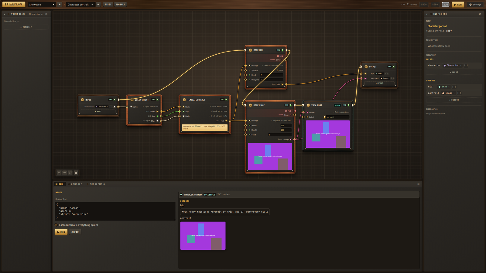

# Briarflow

Briarflow is a strongly typed, graph-based framework for building AI pipelines. You wire together typed nodes — prompt templates, LLM calls, structured outputs, image processing, and your own TypeScript or Python code — into flows that are type-checked before they ever run.

Flows are saved as plain JSON, so the exact same pipeline runs **in-process as a TypeScript library**, **behind a REST + SSE API**, or **visually in Briarflow Studio**.



---

## Features

- **End-to-end static typing** — Primitives (`text`, `int`, `float`, `boolean`), user-defined `struct` and `enum` types, `list`, `optional`, generics (`$T`), and first-class media types (`image`, `video`, `audio`, `model3d`, `file`). Invalid wires, configs, and inputs are caught before execution.
- **Explicit execution, automatic pure data** — Side-effecting steps follow an explicit execution line (with `on fail` error branches), while pure nodes (templates, struct access, image transforms) evaluate lazily on demand.
- **Built for unreliable AI workloads** — Retries with exponential backoff, per-node timeouts, `AbortSignal` cancellation, concurrency limits, real-time progress events, and last-run media carry-over so unchanged steps don't re-run unnecessarily.
- **Ready-to-use node packs** — Built-in standard nodes (text templates, structs, lists, JSON, conversions, variables), pure-JS image manipulation (resize, crop, rotate, split/merge channels, PNG/JPEG convert), OpenAI (Responses & Images APIs), Anthropic (Claude messages & structured outputs), and deterministic mock nodes for offline development and testing.
- **Extensible in TypeScript and Python** — Define typed TypeScript nodes with `defineNode()` / `definePack()`, or expose Python functions (PyTorch, OpenCV, diffusers, etc.) over HTTP using the zero-dependency Python SDK (`@node`, `serve`).
- **Library, HTTP service, and visual studio** — Call flows from TypeScript (`createBriar()`), trigger them over HTTP/SSE (every flow publishes a JSON Schema signature, making it easy to expose flows as webhooks or LLM agent tools), or build and debug them visually in the React studio.
- **Local persistence & secret vault** — Ships with SQLite and filesystem storage backends (plus in-memory stores for tests) and an AES-256-GCM encrypted secret vault for API keys.

---

## Philosophy

Briarflow is built around a few deliberate ideas:

1. **Library first, UI second.** Every capability exists as a clean TypeScript API before it gets an HTTP endpoint or a button in the studio. The server and visual editor are thin consumers of the library, never the other way around.
2. **Data first.** Contexts and flows are plain, deterministic JSON documents. There is no hidden database magic or framework lock-in — flows are easy to inspect, version, diff, and migrate.
3. **Every edit is a command.** Whether an edit comes from code, the REST API, or a drag in the visual editor, it goes through the same atomic JSON command log (`@briarflow/authoring`). That gives one validation path and undo/redo everywhere for free.
4. **Inward dependencies, web-standard primitives.** `@briarflow/core` depends on nothing. All shared packages (`core`, `authoring`, `runtime`, `nodes-std`, `nodes-mock`, `nodes-openai`, `nodes-anthropic`, `client`, `editor`) stick to standard Web APIs (`fetch`, `Promise`, `AbortSignal`, `AsyncIterable`, `ReadableStream`, `Uint8Array`) — no `node:*` imports, no React, no RxJS, no `EventEmitter`.
5. **Small, testable extension contracts.** Storage targets, media stores, secret vaults, and node packs are small interfaces backed by reusable conformance test suites in `@briarflow/testing`.
6. **Human-friendly errors.** Validation diagnostics and runtime errors use stable error codes and plain sentences explaining what went wrong, where it happened, and how to fix it.

---

## Dependencies

### Prerequisites

| Requirement | Version | Needed for |
|---|---|---|
| **Node.js** | `>= 20.19` | Everything (TypeScript library, server, studio) |
| **Python** | `>= 3.10` | Optional — writing and running Python node workers |
| **Docker** | Any recent | Optional — running the all-in-one container |
| **C++ build tools** (`python3`, `make`, `g++`) | — | Only if `better-sqlite3` has no prebuilt binary for your platform |

### Package dependencies

Briarflow keeps its dependency footprint intentionally tiny:

- **Zero runtime dependencies** in `@briarflow/core`, `@briarflow/authoring`, `@briarflow/runtime`, `briarflow`, `@briarflow/client`, `@briarflow/editor`, `@briarflow/nodes-std`, `@briarflow/nodes-mock`, `@briarflow/nodes-openai`, `@briarflow/nodes-anthropic`, `@briarflow/storage-fs`, and `@briarflow/python`.
- **Zero runtime dependencies** in the Python SDK (`python/briarflow`) — Python standard library only.
- **Focused third-party runtime dependencies**, isolated to the packages that need them:

| Package | Runtime dependencies | Why |
|---|---|---|
| `@briarflow/server`, `apps/server` | `hono`, `@hono/node-server` (`tsx` in `apps/server`) | Portable HTTP + SSE server |
| `@briarflow/storage-sqlite` | `better-sqlite3` | Local SQLite persistence for contexts, media registry, runs, vault, and settings |
| `@briarflow/nodes-image` | `fast-png`, `jpeg-js` | Pure-JS PNG/JPEG encoding and decoding (no native ImageMagick/Sharp needed) |
| `@briarflow/editor-react` | `@xyflow/react` (peer: `react` 19, `react-dom` 19) | Interactive node-graph canvas |
| `apps/studio` | `react` 19, `react-dom` 19, `@fontsource/*` | Visual studio UI with self-hosted fonts |

Development and tests use TypeScript (`~5.9`), Vitest (`^4.1`), Vite (`^7.1`), `tsdown`, `tsx`, and `pytest` (Python).

---

## Setup guide

> **Note:** Packages are currently versioned `0.0.0` and not yet published to npm. Everything below runs directly from a checkout of this repository.

### 1. Run locally (recommended for development)

Clone the repository and install dependencies:

```bash
git clone <repo-url> briarflow
cd briarflow
npm install
```

Start the API server and the studio in two terminals:

```bash
# Terminal 1 — REST + SSE server on http://localhost:3000
npm run dev:server

# Terminal 2 — Visual studio on http://localhost:5173 (proxies /api to :3000)
npm run dev:studio
```

Open **http://localhost:5173**. Mock AI nodes are enabled by default, so you can build and run flows immediately without any API keys.

To run the server serving a built production studio on a single port (`http://localhost:3000`):

```bash
npm run build -w @briarflow/studio
npm start
```

### 2. Run with Docker

Everything (server, built studio, SQLite database, and media storage) runs in one container:

```bash
docker compose up --build
```

Or directly with `docker`:

```bash
docker build -t briarflow .
docker run -p 3000:3000 -v briarflow-data:/data briarflow
```

Open **http://localhost:3000** for the studio and **http://localhost:3000/api/v1** for the REST API. All data persists on `/data`.

### 3. Connect AI providers

- **OpenAI:** Always loaded in the server. Open **Settings → OpenAI** in the studio to add your key — it is stored encrypted (AES-256-GCM) in the local vault.
- **Anthropic (Claude):** Set `ANTHROPIC_API_KEY` before starting the server (or pass `-e ANTHROPIC_API_KEY=sk-ant-...` to `docker run`).

### 4. Use Briarflow as a TypeScript library

You don't need the server or studio to author and run flows:

```ts
import { createBriar } from "briarflow";
import { mockPack } from "@briarflow/nodes-mock";

const briar = createBriar({ packs: [mockPack] });

const ctx = await briar.contexts.create({ name: "Demo" });
const flow = ctx.flows.create("Poster");
flow.inputs.add("topic", "string");
flow.outputs.add("caption", "string");
flow.outputs.add("poster", "Image");

const llm = flow.nodes.add("mock.llm");
const image = flow.nodes.add("mock.image");
flow.connect(flow.input.port("topic"), llm.port("prompt"));
flow.connect(llm.port("text"), image.port("prompt"));
flow.connect(llm.port("text"), flow.output.port("caption"));
flow.connect(image.port("image"), flow.output.port("poster"));
flow.line(flow.input, llm, image, flow.output);
await ctx.save();

const run = await briar.run(flow.id, { topic: "a lighthouse at dusk" });
const result = await run.result;
console.log(result.status, result.outputs);

await briar.close();
```

Swap `mockPack` for `openaiPack()` or `anthropicPack()` for real models, and pass `SqliteContextStore` / `FsMediaStore` when you want disk persistence.

### 5. Optional: Python node workers

Set up a virtual environment for the Python SDK:

```bash
python3 -m venv python/.venv
python/.venv/bin/pip install -e 'python[test]'
```

Run the example worker (or your own `@node` script) and point the server at it:

```bash
python/.venv/bin/python python/examples/imaging_nodes.py
# In another terminal:
BRIAR_PYTHON_WORKER_URL=http://127.0.0.1:8765 npm run dev:server
```

See [python/README.md](python/README.md) and [docs/guides/python-nodes.md](docs/guides/python-nodes.md) for writing custom Python nodes.

### 6. Verify your setup

```bash
npm test                     # Boundary check + all Vitest suites
npm run typecheck            # TypeScript checks (including strict shared-package rules & studio)
npm run smoke                # End-to-end smoke check (requires server running on :3000)
cd python && .venv/bin/python -m pytest
```

---

## Configuration

The bundled server (`apps/server`) is configured via environment variables:

| Variable | Default | Purpose |
|---|---|---|
| `PORT` | `3000` | HTTP listen port |
| `HOST` | `127.0.0.1` (`0.0.0.0` in Docker) | Bind address |
| `BRIAR_DATA_DIR` | `./data` (`/data` in Docker) | Directory for `briarflow.db`, `vault.key`, and `media/` |
| `BRIAR_VAULT_KEY` | `<BRIAR_DATA_DIR>/vault.key` | 64-char hex key for AES-256-GCM vault encryption (auto-generated if omitted) |
| `BRIAR_CORS_ORIGIN` | `http://localhost:5173,http://127.0.0.1:5173` | Comma-separated allowed origins, or `off` |
| `BRIAR_STUDIO_DIR` | `apps/studio/dist` | Path to built studio served at `/` (`off` to run headless) |
| `BRIAR_STUDIO_CONTEXT`, `BRIAR_STUDIO_FLOW` | — | Default context/flow opened by the studio (auto-created if missing) |
| `BRIAR_MOCK_NODES` | `true` | Enable deterministic mock nodes |
| `BRIAR_PYTHON_WORKER_URL`, `BRIAR_PYTHON_WORKER_TOKEN` | — | Attach a remote Python worker pack at startup |
| `ANTHROPIC_API_KEY` | — | Enables the `@briarflow/nodes-anthropic` pack |
| `BRIAR_LOG_LEVEL` | `info` | Log verbosity (`debug`, `info`, `warn`, `error`) |

> **Security note:** `apps/server` ships without built-in authentication. Keep it on `localhost` / a private network, put an authenticating reverse proxy in front of it, or embed `@briarflow/server` (`createBriarApp`) with your own `authorize` hook. Do not point multiple server processes at the same SQLite database file.

---

## Learn more

- **Architecture & roadmap:** [docs/ARCHITECTURE.md](docs/ARCHITECTURE.md) · [docs/STATUS.md](docs/STATUS.md) · [docs/DECISIONS.md](docs/DECISIONS.md)
- **Guides:** [Writing TypeScript nodes](docs/guides/writing-nodes.md) · [Writing Python nodes](docs/guides/python-nodes.md) · [Writing a storage backend](docs/guides/writing-a-store.md)
- **Specs:** [Types](docs/specs/types.md) · [Node API](docs/specs/node-api.md) · [Execution](docs/specs/execution.md) · [Runtime](docs/specs/runtime.md) · [REST API](docs/specs/rest-api.md) · [Media](docs/specs/media.md) · [Storage](docs/specs/storage.md) · [Commands](docs/specs/commands.md)
- **Contributing:** [AGENTS.md](AGENTS.md)

## License

[MIT](LICENSE)
