# Platform architecture: scopes, sessions, plugins and deployment

Status: **proposal** (2026-10-25). Planning notes, not yet implemented. It records the decisions
from the planning discussion and the details chosen to make them concrete. Current behaviour is
in `docs/ARCHITECTURE.md` and `docs/specs/*`; section 10 lists what changes.

## 0. Summary

Briarflow is a **framework** that developers add to their own systems. The backend library, the
REST server and the studio are components of that framework, not a product with opinions about
who designs flows or who runs them. The integrating developer can build any of these:

- a single-user tool;
- a product where every end user designs their own flows;
- a backend that only calls flows;
- a hosted service.

The framework provides the boundaries those products need. It does not provide the product.

Five decisions shape the design:

| # | Decision |
|---|---|
| D1 | **Scopes.** Every stored resource belongs to an opaque scope id. The framework enforces scope boundaries and never interprets the id: users, organizations and projects belong to the application layer. |
| D2 | **Sessions.** Results of runs are tracked per session inside a scope, not per flow. A session's meaning (conversation, document, job) is up to the application. Runs without a session are ephemeral. |
| D3 | **Plugins.** The distribution unit is a plugin: one npm package holding one or more packs, with one version. Ids are plugin-qualified (`figma/debug.print`), so there are no vendor prefixes and no per-pack versions. |
| D4 | **Plugin registry.** Community plugins live in a separate npm-compatible registry that accepts a release only after community review. Their ordinary npm dependencies come from the public registry. |
| D5 | **Type identity.** A plugin type is identified by plugin, major version, pack and name (`tensor@1/ml.Tensor`). The same major is the same type everywhere; different majors are different types, joined only by declared converters. Types are nominal: two plugins' look-alike types never match silently. |

---

## 1. Layers and responsibilities

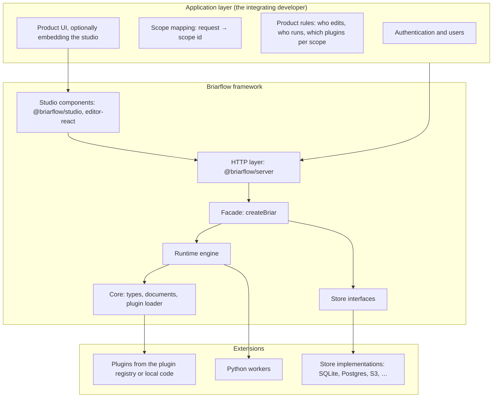

| Layer | Owns | Never does |
|---|---|---|
| Application | Login, users, organizations, billing, mapping a request to a scope, deciding which plugins a scope may use | Reach into store internals |
| Framework | Documents, validation, runs, sessions, media, the vault, plugin loading, enforcing scope boundaries, the HTTP API, studio components | Know what a user is, or what a scope means |
| Extensions | Nodes, types, converters, storage backends | Depend on another plugin's code (only on its declared types and nodes) |

---

## 2. System diagram (deployments)

The same framework runs in three deployment shapes. Shape 3 is shape 2 with an account layer and
isolation in front.

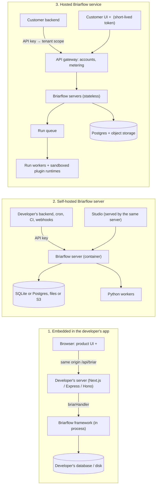

---

## 3. Component diagram

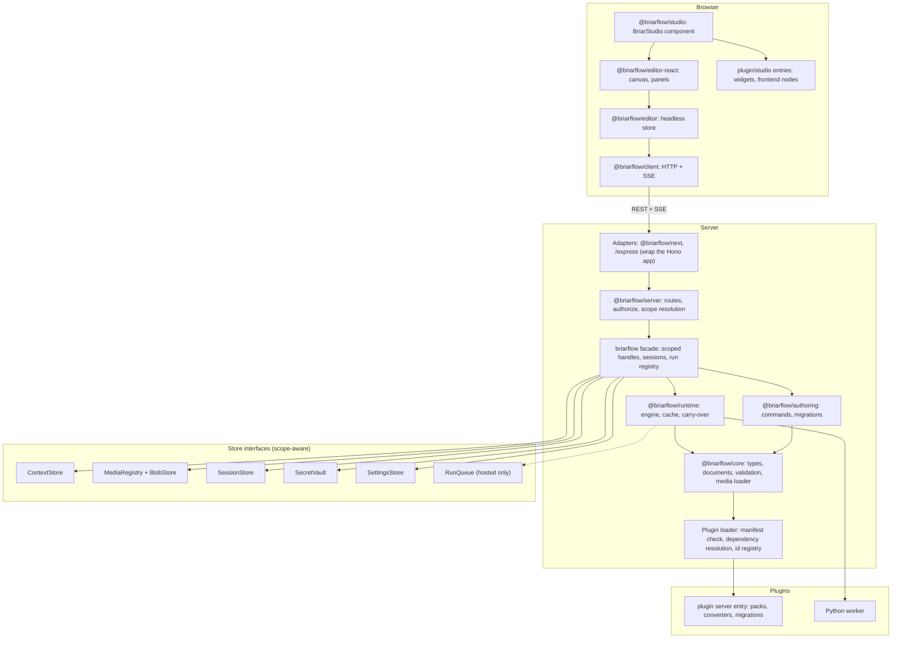

---

## 4. Scopes

### 4.1 Model

- A **scope** is an opaque string id, `^[A-Za-z0-9_.:-]{1,128}$`. Single-tenant installs use the
  scope `default`.
- These resources carry a scope: contexts, media entries, sessions (and their runs), vault
  secrets, settings values, and the per-scope plugin allowlist.
- **Plugins are installed per process and enabled per scope.** Loading code is a deploy-time
  decision. Which installed plugins a scope sees is decided by the application at request time.
- There is no nesting in v1: a scope cannot see another scope's resources. Shared templates are
  copied into the scope that uses them (see section 12).

### 4.2 API

```ts
const briar = createBriar({ stores, plugins: [figmaPlugin, tensorPlugin()] });

// Library use: every handle is bound to a scope.
const acme = briar.scope("acme-42", { plugins: ["figma"] });   // allowlist; omitted = every installed plugin
await acme.contexts.create({ name: "Marketing" });
await acme.run("flow_portrait", inputs, { session: "sess_9" });

// HTTP use: the application resolves the scope per request.
app.use("/api/briar", briarExpress(briar, {
  scope: async (req) => ({ id: await myOrgOf(req), plugins: await planPlugins(req) }),
  authorize: ({ action, scope, resource }) => myPolicy(action, scope, resource),  // optional, finer rules
}));
```

- `scope()` returning `undefined` answers `401 scope.required`. Resources outside the scope
  answer `404`, never `403`, so their existence is not revealed.
- Store interfaces receive the scope on every call (`store.load(scope, contextId)`); an
  implementation must not return another scope's rows. The conformance suites test this.
- Flow ids stay globally unique; lookups are always made inside a scope.

---

## 5. Sessions and runs

### 5.1 Data layers

| Layer | Lifetime | Holds | Written by |
|---|---|---|---|
| **Context** | Long-lived, shared by everyone in the scope | Flows, types, globals (configuration) | Authoring commands only |
| **Session** | As long as the application says (TTL) | Session variables, each flow's last result in the session, run history, carry-over artifacts | Runs, and the application |
| **Run** | One call | Inputs, events, result | The engine |

Variables resolve **run → session → context**.

**Run writes go to the session.** A run never changes the context document: `global.set` in a
run writes a session variable with the same name. Changing context globals is an authoring
action (a command), not a run side effect. This replaces today's write-back of readwrite globals.

### 5.2 Session record

```ts
interface Session {
  id: string;                 // ses_…
  scope: string;
  contextId: string;          // a session works with one context
  label?: string;
  metadata?: Record<string, JsonValue>;   // the application's own data (opaque)
  variables: Record<string, unknown>;     // session-level values by global name
  flows: Record<flowId, { lastRunId: string; status: RunStatus; finishedAt?: string }>;
  createdAt: string;
  expiresAt?: string;         // default: never; the application sets a TTL
}
```

- Every run in a session keeps a `LastRun`-style record (today's per-flow record moves here,
  keyed by session + flow). Run history keeps `historyLimit` runs per session and flow (default
  20). Older runs keep their metadata, and their transient media is deleted.
- **Carry-over** works as today, inside session + flow: a media-making node with the same reuse
  key as the last run of that flow *in this session* is reused.
- **Media lifetime.** Transient media is owned by `{ scope, session, run }`. It goes when its run
  falls out of the session's history or the session expires. Media from ephemeral runs lives for
  `ephemeralMediaTtl` (default 1 hour).
- **The studio** opens an editor session per editor tab, labelled `studio`. This is exactly
  today's "last run" behaviour, now with a name.

### 5.3 Ephemeral runs

`POST /flows/:id/runs` without a session runs with no carry-over and no session variables, and
keeps its result for the run-retention window. Simple integrations get stateless calls this way.

### 5.4 Flow versions

Editing a flow must not change runs that production already depends on.

- `flow.publish` (command) freezes the current flow as version `n`, an immutable snapshot of the
  flow and of the types it uses.
- Calls name a version: `portrait` (= `portrait@latest`, the newest published version),
  `portrait@3`, or `portrait@draft` (the editable working copy; the studio uses this).
- A run records the version it ran. Session carry-over keys include the version.
- Flows are addressed by a scope-unique **slug** (`portrait`) as well as by id, so integrations
  do not hard-code generated ids.

---

## 6. Plugins

### 6.1 Terms and ids

| Term | Meaning |
|---|---|
| **Plugin** | The distribution unit: one npm package, one version, a manifest. Contains one or more packs and optionally converters, migrations, store implementations and studio code. |
| **Pack** | A named group inside a plugin (a namespace for nodes and types). Packs have no version of their own. |
| **Node type id** | `<plugin>/<pack>.<node>`, e.g. `figma/debug.print`. Stored this way in documents. |
| **Type id** | `<plugin>@<major>/<pack>.<Type>`, e.g. `tensor@1/ml.Tensor`. The major is part of a type's identity (section 7). |
| **Built-ins** | The standard library is the plugin `briar`: `briar/text.template`, `briar@1/…`. |

Plugin names match `^[a-z][a-z0-9-]{1,39}$` and are unique in the registry. The studio shows short
names (`Print`, `Tensor`) and adds the plugin, or the major, only when two would look the same.

### 6.2 Manifest

Each plugin ships a static manifest, `briarflow-plugin.json`. The registry, the review tooling
and the loader can then read everything without running the plugin's code. The code exports a
`definePlugin(...)` that must agree with it; the loader checks this.

```jsonc
{
  "$schema": "https://briarflow.dev/schemas/plugin-manifest-1.json",
  "manifestVersion": 1,
  "name": "tensor",                          // plugin id
  "version": "1.4.2",                        // the only version (semver)
  "displayName": "Tensor",
  "description": "N-dimensional arrays and operations on them.",
  "author": "Ada Example <ada@example.com>",
  "license": "MIT",
  "repository": "https://github.com/example/briarflow-tensor",

  "engines": { "briarflow": "^1.0" },        // framework range (checked at load)

  "entry": {
    "server": "./dist/server.js",            // packs, converters, migrations (Node or portable)
    "shared": "./dist/shared.js",            // optional: portable code the studio may also load
    "studio": "./dist/studio.js"             // optional: widgets, frontend node handlers
  },

  "packs": {
    "ml": {
      "title": "Machine learning",
      "nodes": ["matmul", "relu", "fromImage"],          // generated by `briarflow plugin build`
      "types": { "Tensor": { "public": true }, "Shape": { "public": true }, "Cache": { "public": false } }
    }
  },

  "dependencies": {                          // other plugins (shared, section 7)
    "image": "^1.2"
  },

  "converters": [                            // between majors, or to other plugins' types
    { "from": "tensor@0/ml.Tensor", "to": "tensor@1/ml.Tensor", "node": "tensor/ml.upgradeV0" }
  ],

  "permissions": {                           // declared, reviewed; enforced in sandboxes
    "network": ["api.example.com"],
    "filesystem": "none",                    // none | temp | read | readwrite
    "childProcess": false,
    "env": []
  },

  "settings": ["defaultDevice"],             // declared in code; listed for review and UIs
  "secrets": []
}
```

- The plugin's `package.json` declares `@briarflow/core` (and `react` for studio entries) as
  **peerDependencies**. Ordinary libraries are normal `dependencies`.
- `briarflow plugin build` generates the `packs` section from the code and fails if the code
  and the manifest disagree.

```ts
// src/server.ts
import { definePlugin, definePack } from "@briarflow/core";
export default definePlugin({
  manifest: "../briarflow-plugin.json",
  packs: [definePack({ name: "ml", nodes: [matmul, relu, fromImage], types: [Tensor, Shape, Cache] })],
  migrations,          // section 8
  converters: { upgradeV0 },
});
```

Plugin entries are the one place where a default export is used (the loader imports the entry
by path). Framework packages keep the named-exports rule.

### 6.3 The contract between plugins

A plugin depends on another plugin only through the other's **public surface**:

1. **Public types** (`"public": true`): their ids, fields and field types. A plugin may use them
   in its own ports, its struct fields and its converters.
2. **Nodes:** a plugin may reference another plugin's nodes by id, for example in converters,
   templates or subflows (later).

Everything else is private: classes, functions, singletons, private types. A plugin must not
import another plugin's JavaScript. The loader enforces this:

- type references across plugins must name a public type of a declared dependency;
- review rejects code that imports another plugin's package.

Values cross plugin boundaries as plain JSON (the same rule as today), so two plugins' code
never needs to share an object.

**What counts as a breaking change** (requires a new major; the registry's compatibility check
enforces it):

| Change to a public type or a node | Minor | Major |
|---|---|---|
| Add an optional struct field, or a field with a default | ✓ | |
| Add an enum member | ✓ | |
| Add a node, an optional input, or an output | ✓ | |
| Remove or rename a type, field, enum member, node, port or config field | | ✓ |
| Change a field's or a port's type, or make an optional field required | | ✓ |
| Remove a variant | | ✓ |

### 6.4 Where plugins come from

| Source | How it is installed | Trust |
|---|---|---|
| **Plugin registry** (community, reviewed) | `npm install @briarflow-plugins/tensor`, with `.npmrc`: `@briarflow-plugins:registry=<plugins-registry-url>` | Reviewed source, reproducible build, signed |
| **Local plugin** (the developer's own code) | An import from the developer's repo, or any npm package | The developer's own responsibility; loads with a startup notice `plugin.unreviewed` |
| **Python worker** | `pythonPack({ url, token })`; the worker publishes a manifest in the same format | Its own process |
| **Uploaded by an end user** (hosted service only, later) | Never loaded into the server process; runs in a sandboxed runtime | Untrusted; permissions enforced |

Plugins are registered **explicitly in code** (`createBriar({ plugins: [...] })`). Nothing is
discovered or installed at runtime.

---

## 7. Dependency resolution and type identity

### 7.1 Two kinds of dependency

| Kind | Example | Resolution |
|---|---|---|
| **npm package** (code) | `fast-png`, `onnxruntime-node` | Isolated: npm installs whatever versions each plugin asks for, nested where they differ. Nobody notices. |
| **Plugin** (types and nodes) | `image`, `tensor` | Shared: **one loaded copy per major** across the whole install, the highest version that satisfies every range for that major. |

### 7.2 Rules

1. For each plugin, group every requested range by major and choose the highest installed version
   per major that satisfies all ranges in that group. If none does, fail at startup with
   `plugin.dependency_conflict`, naming the requesters and their ranges.
2. Several majors of one plugin may be loaded side by side. Each brings its own types
   (`tensor@1/…` and `tensor@2/…`) and its own nodes.
3. **Same id and same major means the same type**, everywhere and in every document. Minor
   releases are guaranteed compatible by the registry check (section 6.3).
4. **Different majors are different types.** A wire between them is rejected, unless a converter
   is declared, in which case the editor offers to insert the converter node (the same mechanism
   that inserts "As text" today).
5. **Types are nominal.** `tensor@1/ml.Tensor` and `torch@1/nn.Tensor` are different even when
   their fields match. Only a declared converter connects them: same fields can mean different
   things (row-major vs column-major, metres vs feet).
6. **Node ids in a document refer to one major per plugin.** The document's plugin table pins
   that major. Types used by those nodes may come from other majors, through dependencies, and
   carry the major in their ids.
7. Plugin-to-plugin dependency cycles are rejected at load (`plugin.dependency_cycle`).

### 7.3 Example

`vision` depends on `tensor ^1.2`, `audio` on `tensor ^1.4`, and `legacy-ml` on `tensor ^0.9`.

- Loaded: `tensor` 1.4.x (shared by `vision` and `audio`) and `tensor` 0.9.x (for `legacy-ml`).
- `vision`'s `Tensor` output wires straight into `audio`'s `Tensor` input: both are
  `tensor@1/ml.Tensor`.
- `legacy-ml`'s `tensor@0/ml.Tensor` output into `vision`'s input: rejected. Because tensor 1.x
  declares the converter `tensor@0 → tensor@1`, the editor offers "Insert Upgrade tensor".
- In the studio, the pins show `Tensor · v0` and `Tensor · v1`, because two majors are loaded.

---

## 8. Documents, plugin versions and migrations

### 8.1 What a document records

```jsonc
{
  "format": "briarflow.context",
  "formatVersion": 2,
  "plugins": {                         // every plugin the document's nodes and types use
    "briar":  { "version": "1.6.0" },  // the version last saved with (exact)
    "figma":  { "version": "2.3.1" },
    "tensor": { "version": "1.4.2" }
  },
  "flows": [ { "nodes": [ { "type": "figma/debug.print", … } ] } ],
  "types": [ { "fields": [ { "name": "weights", "type": { "kind": "named", "id": "tensor@1/ml.Tensor" } } ] } ]
}
```

The table is maintained by authoring: adding a node, or using a type, adds its plugin or raises
the recorded version.

### 8.2 When a document is opened

| Installed vs recorded | Result |
|---|---|
| Same major, same or newer minor | Opens normally; the recorded version is updated on the next save. |
| Same major, **older** minor | Opens. Nodes or fields the older version lacks show `plugin.too_old`; runs that need them fail with that code. |
| Plugin **missing** | Opens. Its nodes become placeholders that keep their data, ports and wires (`plugin.missing`), and runs that reach them fail. Nothing is deleted. |
| **Newer major** installed (recorded 1.x, installed 2.x) | Opens with an **upgrade notice**. Runs fail with `plugin.upgrade_required` until the document is upgraded. |
| Both majors installed | Opens and runs on the recorded major; upgrading stays optional. |

Documents are never migrated silently on load. Upgrading is an authoring command, so it is
undoable and saved like any edit.

### 8.3 Migrations

A plugin exports migrations for each major it introduces:

```ts
export const migrations = defineMigrations({
  "2.0.0": {
    nodes: {
      "ml.matmul": (node) => ({ ...node, config: { ...node.config, precision: node.config.fp16 ? "half" : "full" } }),
      "ml.oldNode": { replaceWith: "ml.newNode", ports: { in: "input" } },
    },
    types: {
      "ml.Tensor": { renameFields: { dims: "shape" } },   // also rewrites stored values of the type
    },
  },
});
```

- The command `plugin.upgrade { plugin, to }` runs every migration step between the recorded and
  the target version, in order. It rewrites node configs, values, ports and wires, type fields
  and stored values, and records the new version. It also returns a report: what changed, and
  what needs a person (a removed node without a replacement becomes a placeholder).
- The studio shows the report before applying it.
- Published flow versions (section 5.4) are snapshots: they keep running on the major they were
  published with, as long as that major is installed. A document upgrade is followed by a new
  publish.

---

## 9. The plugin registry

### 9.1 Shape

- An npm-compatible registry (Verdaccio or equivalent) serving the scope `@briarflow-plugins`.
  The npm package name is `@briarflow-plugins/<plugin name>`.
- Proxy-free: the registry stores only plugins. Ordinary dependencies resolve from npmjs as
  usual.
- An index repository (`briarflow-plugins`) holds one entry per plugin: the source repository,
  the maintainers, and the approved release commits.

### 9.2 Review gate

- A release is a pull request to the index that names a commit of the plugin's source. Reviewers
  check:
  - the code;
  - the declared permissions against what the code does;
  - the npm dependency lockfile;
  - that the plugin does not import other plugins' code.
- Automated checks run on every pull request:
  - the manifest schema;
  - `briarflow plugin build` agreeing with the manifest;
  - the compatibility check against the previous release (section 6.3);
  - the plugin's tests and `describePlugin` conformance.
- After approval, CI builds from the named commit with the lockfile, signs the tarball (npm
  provenance) and publishes. Authors cannot publish directly, so the reviewed code is the
  published code.
- **Known limit:** reviewers see a plugin's npm dependencies only as the pinned lockfile, not
  their code. Plugins needing `childProcess` or a wide `network` permission get a closer review,
  and a hosted service runs them only in sandboxes.

### 9.3 Installing

```bash
# .npmrc (once)
@briarflow-plugins:registry=<plugins-registry-url>

npm install @briarflow-plugins/tensor @briarflow-plugins/figma
```

```ts
import tensor from "@briarflow-plugins/tensor";
import figma from "@briarflow-plugins/figma";
const briar = createBriar({ stores, plugins: [tensor, figma] });
```

---

## 10. The studio as a component

```tsx
import { BriarStudio } from "@briarflow/studio";
import figmaStudio from "@briarflow-plugins/figma/studio";   // only plugins with browser code

<BriarStudio
  api="/api/briar"                      // same origin recommended
  context="ctx_marketing"               // or omit to show the scope's context list
  flow="portrait@draft"
  session="ses_9"                       // which session's results to show
  features={{ contexts: false, settings: false, vault: false, types: true, console: true }}
  readOnly={false}
  plugins={[figmaStudio]}
  theme="wood"                          // or CSS variables
/>
```

- **Three integration levels:**
  - the drop-in `<BriarStudio>`;
  - the building blocks (`FlowCanvas`, `RunPanel`, `Inspector`, …) for custom layouts;
  - `<briar-studio>`, a web component, and an iframe route for apps that do not use React.
- A plugin without studio code still works in the studio: nodes come from server descriptors,
  with default widgets.
- `apps/studio` becomes a thin page around `<BriarStudio>`.

---

## 11. Flows of each scenario

### 11.1 Embedding in a developer's app (scenario 1)

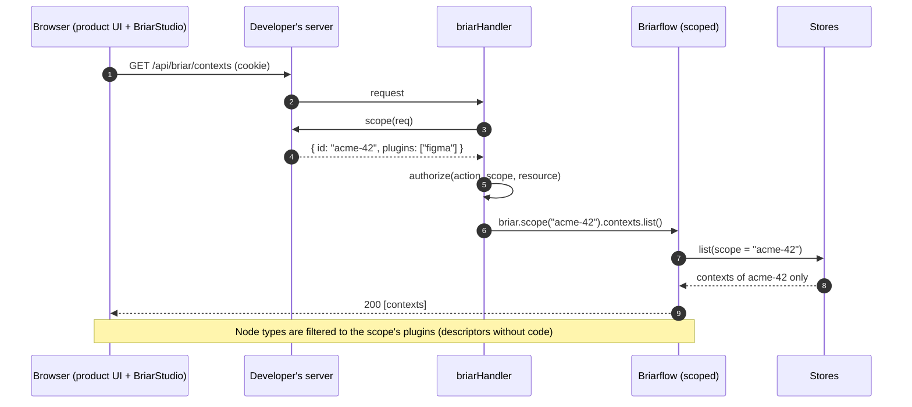

### 11.2 Self-hosted server called from a backend, with a session (scenario 2)

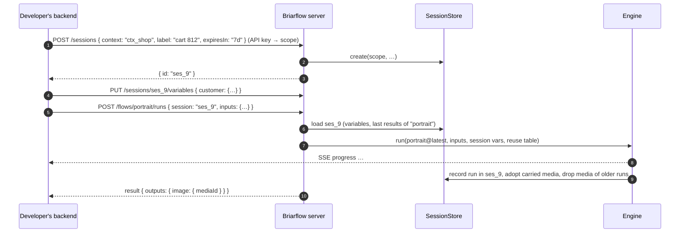

### 11.3 Hosted service (scenario 3)

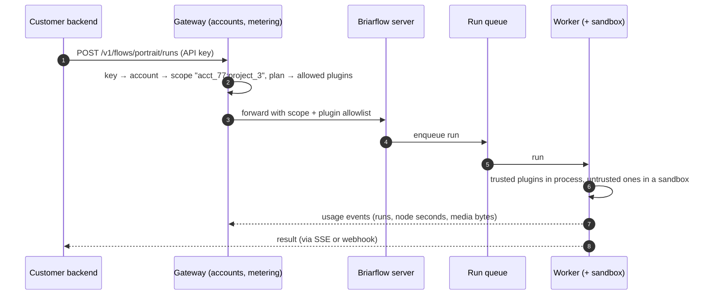

### 11.4 Loading plugins at startup

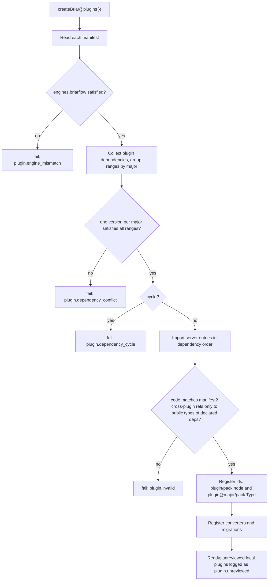

### 11.5 Publishing a plugin

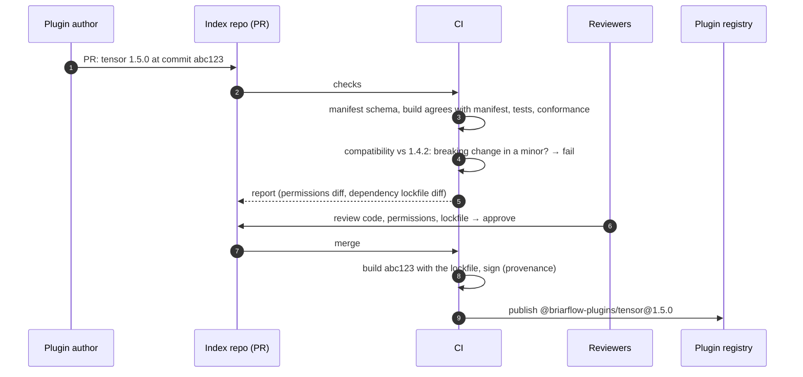

### 11.6 Wiring two majors of a type

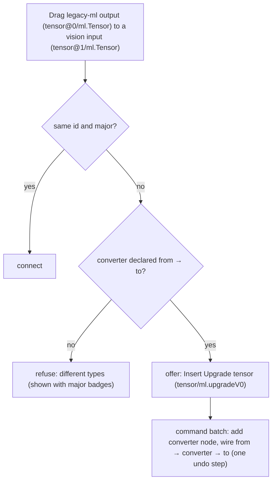

### 11.7 Opening a document with plugin changes

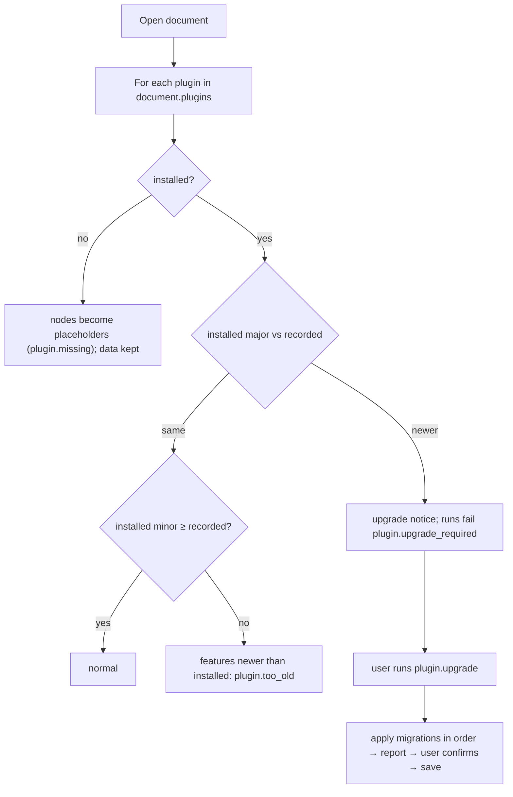

### 11.8 A run in a session: carry-over and clean-up

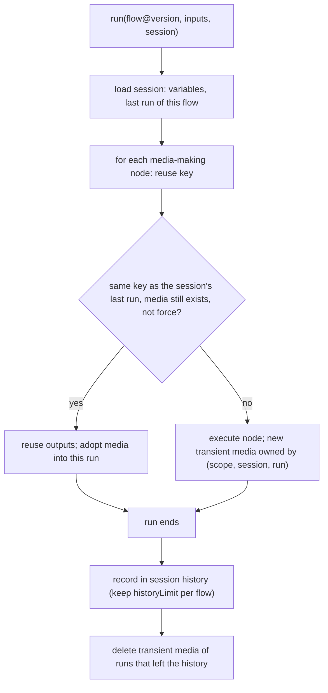

### 11.9 Session expiry

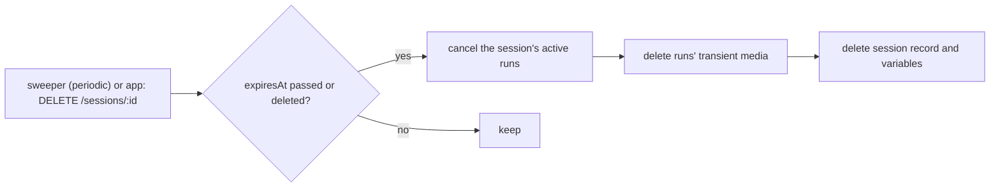

### 11.10 Publishing and calling flow versions

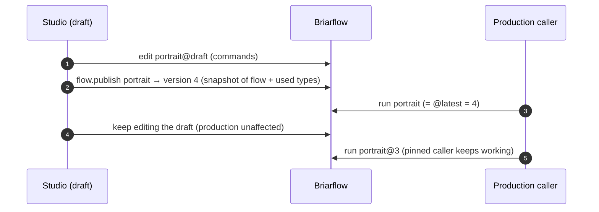

---

## 12. Decisions on the open questions

| Question | Decision | Why |
|---|---|---|
| Id separator | `plugin/pack.node`; `plugin@major/pack.Type` for types | `@` means "version" in the JS world; `/` reads as "belongs to". |
| Pack versions | None; only plugin versions | One version per distributable unit is what npm and users understand. |
| Vendor prefixes | Not needed | The plugin name qualifies every id. |
| Nested scopes | Not in v1 | Copying shared templates covers the first products; nesting changes every query. |
| Run writes to globals | Go to the session | A shared document must not change under concurrent users. |
| Silent migration on load | Never | Upgrades are reviewed, undoable commands. |
| Missing plugin | Placeholder nodes; nothing deleted | Documents outlive installs. |
| Same-shaped types from different plugins | Different types | Nominal typing avoids silently wrong results. |
| Runtime plugin install | Not supported | Explicit imports keep types, bundling and trust clear. |
| Unreviewed plugins | Allowed locally, with a startup notice | It is the developer's own code; the registry is for distribution. |
| Permissions | Declared and reviewed; enforced only in sandboxes | In-process code cannot be confined; declarations drive review and hosted sandboxing. |
| Session naming | "session" | Familiar; the docs distinguish it from authentication sessions. |

---

## 13. Changes from today

| Area | Today | After |
|---|---|---|
| Stores | No scope | Every store call takes a scope; conformance tests check isolation |
| `createBriar` | One shared world | `briar.scope(id)`; HTTP adapters with `scope()` and `authorize()` |
| Last run | Per flow (`LastRunStore`) | Per session + flow (`SessionStore`); the studio uses an editor session |
| readwrite globals | Runs write back into the context | Runs write session variables; context changes only by command |
| Node ids | `pack.node` (`openai.image`) | `plugin/pack.node` (`openai/openai.image`); old ids map through an alias table during migration |
| Pack types | `<pack>.<Name>` | `<plugin>@<major>/<pack>.<Name>` |
| Packs | `definePack` passed directly | `definePlugin` with a manifest; existing node packages become plugins |
| Documents | `formatVersion: 1`, no plugin table | `formatVersion: 2` with `plugins`; a one-time format upgrade fills the table and rewrites ids |
| Flows | Run by id; edits are live | Slugs, `@draft` / `@latest` / `@n` versions |
| Studio | An app (`apps/studio`) | `@briarflow/studio` component; the app wraps it |
| Server | `createBriarApp` | Plus `@briarflow/next` and `@briarflow/express` adapters |

---

## 14. Delivery order

1. **Scopes** in store interfaces, the facade and the HTTP layer, with conformance tests. Every
   later step depends on this.
2. **Sessions:** session store, run history, session variables, run writes to the session, and
   moving last runs and carry-over into sessions.
3. **Plugins:**
   - manifest, `definePlugin`, loader and dependency resolution;
   - plugin-qualified ids and the document format 2 upgrade;
   - existing packages become plugins.
4. **Migrations** and `plugin.upgrade`; converters and their insertion in the editor.
5. **Packaging:**
   - npm publishing;
   - `@briarflow/studio` as a component;
   - the Next.js and Express adapters;
   - example apps for scenarios 1 and 2.
6. **Flow versions:** publish, slugs, version-pinned calls.
7. **Registry:** index repository, CI checks, compatibility checker, signed publishing.
8. **Hosted service** (when needed): run queue, Postgres and S3 stores, gateway, metering,
   sandboxed plugin runtime.

## 15. Still open

- Subflows (a flow calling another flow, possibly a template from another scope) and how they
  interact with versions and scopes.
- Whether a session may span several contexts.
- Limits per scope (runs per minute, storage), which the hosted service needs and self-hosted
  installs may want too.
- Licensing of the framework and of registry plugins, before the first public release.
